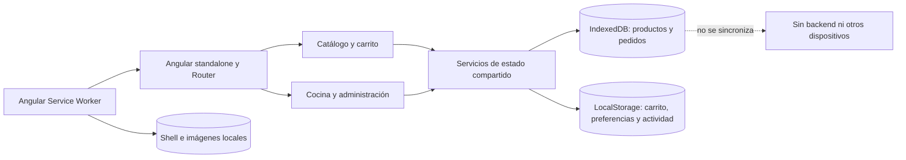

# FastOrder — demostración PWA frontend

FastOrder es una aplicación demostrativa de pedidos para restaurante implementada con Angular 21.2.21. Su identidad visual combina dorado y azul petróleo oscuro, tipografía DM Sans para textos y Outfit para títulos, imágenes locales de productos, tarjetas de menú, hero de promoción y navegación a carrito, cocina y administración.

**Límite funcional:** todo el estado pertenece al navegador actual. No hay backend, servidor de aplicación, API, base de datos externa, autenticación real, pagos ni envío real de pedidos. Cocina y Administración usan un inicio de sesión de demostración en frontend; no protege la aplicación contra usuarios que inspeccionen o modifiquen el cliente. Los pedidos guardados sin conexión no se sincronizan cuando vuelve Internet.

## Inicio en Windows PowerShell

Desde la raíz del repositorio:

```powershell
npm ci
npm start
```

Abre `http://localhost:4200/`. La tienda y las funciones de cliente son públicas; Cocina y Administración requieren iniciar sesión en `/login`. El formulario no muestra ni precarga las credenciales de demostración. Angular ejecuta Service Worker sólo en la configuración de producción; `ng serve` es para desarrollo.

## Compilar y ejecutar las pruebas

```powershell
npm test -- --watch=false
npm run build
```

La salida de producción está en `dist\Order_fast\browser`. La compilación de producción incorpora `ngsw-worker.js` y `ngsw.json`. Para probar la PWA, publica esa carpeta en un origen HTTPS o `localhost`, ábrela en un navegador compatible y espera a que el Service Worker termine de instalar y almacenar los recursos.

## Desplegar en Vercel

El archivo `vercel.json` configura la instalación con `npm ci`, la compilación con `npm run build`, la salida estática en `dist/Order_fast/browser` y el fallback a `index.html` para que Angular Router pueda abrir rutas como `/cocina`, `/admin` y `/login` directamente.

### Publicación desde Git

1. Sube el repositorio a GitHub, GitLab o Bitbucket.
2. En Vercel, selecciona **Add New... → Project** e importa ese repositorio.
3. Deja que Vercel use los comandos y el directorio definidos en `vercel.json`; el proyecto no requiere variables de entorno ni configuración de backend.
4. Pulsa **Deploy**. Para futuras actualizaciones, Vercel volverá a compilar al subir cambios a la rama conectada.

También puedes desplegar desde Windows PowerShell con la CLI oficial de Vercel, iniciando sesión y ejecutándola desde la raíz del proyecto:

```powershell
npx vercel
npx vercel --prod
```

La primera orden crea o vincula el proyecto y genera la vista previa; la segunda publica en producción. La PWA requiere HTTPS, que Vercel proporciona en los dominios desplegados. Tras abrirla y completar una carga inicial satisfactoria, el Service Worker puede almacenar los recursos de la aplicación para visitas offline. Los pedidos, productos administrados y otros datos siguen guardados en el navegador del dispositivo y no se comparten entre usuarios o dispositivos; no existe sincronización ni recepción real de pedidos.

## Arquitectura y responsabilidades



- `src/app/app.routes.ts`: rutas Angular con carga diferida para catálogo, carrito, pedidos, inicio de sesión, cocina y administración; `src/app/core/staff-access.guard.ts` protege las rutas operativas durante la demo.
- `src/app/features/auth/login-page.ts` y `src/app/services/auth.service.ts`: inicio de sesión de demostración para personal sin registro; la sesión se conserva en `sessionStorage` hasta cerrar sesión o la pestaña.
- `src/app/features/customer/customer-page.ts`: búsqueda, filtro por categoría, menú y alta de productos al carrito.
- `src/app/features/cart/cart-page.ts`: cantidades, notas, nombre del pedido, cupón demostrativo y confirmación local.
- `src/app/features/customer/orders-page.ts`: historial local y filtros.
- `src/app/features/kitchen/kitchen-page.ts`: tablero por estado y transición de pedidos.
- `src/app/features/admin/admin-page.ts`: indicadores, actividades, catálogo, categorías, pedidos, reportes y preferencias.
- `src/app/models/fast-order.ts`: tipos, categorías y catálogo inicial de demostración.
- `src/app/services/product.service.ts`: catálogo compartido y administración de productos y categorías.
- `src/app/services/cart.service.ts`: estado del carrito compartido y cálculos de cantidades y subtotal.
- `src/app/services/order.service.ts`: alta, consulta y estados de pedidos persistidos.
- `src/app/services/local-database.service.ts`: acceso tipado a IndexedDB.
- `src/app/services/local-storage.service.ts`: lectura y escritura de preferencias y registros sencillos.
- `src/app/services/activity.service.ts`: historial local de actividad administrativa y de cocina.
- `src/app/services/online-status.service.ts`: estado de conexión actual del navegador.
- `src/app/services/notification.service.ts`: avisos locales sujetos a permiso del navegador.

## Persistencia

IndexedDB (`fastorder-local`) tiene los almacenes `products` y `orders`. La primera carga inicia el catálogo de demostración; las modificaciones de productos y los pedidos se conservan en el mismo navegador. El carrito, las categorías y la actividad utilizan LocalStorage. Los errores de persistencia se registran y se notifican en la interfaz.

Los pedidos se crean como `Guardado local` cuando el navegador está en línea y como `Pendiente local` si está desconectado. “En línea” sólo describe la conexión del dispositivo: **no significa que FastOrder haya enviado el pedido al restaurante**. No se muestra ningún estado de sincronización porque no hay servidor.

## PWA, caché e instalación

- `src/app/app.config.ts` registra Angular Service Worker en producción; permanece deshabilitado durante desarrollo.
- `ngsw-config.json` descarga anticipadamente los archivos JavaScript, CSS, el shell de la aplicación, el manifiesto y las imágenes locales de `public/products`.
- Los iconos de interfaz usan Material Symbols Rounded servidos por Google Fonts. El Service Worker precarga la hoja de estilos y la fuente remotas para conservarlos en visitas posteriores y, cuando se almacenaron correctamente, sin conexión.
- El manifiesto `public/manifest.webmanifest` define nombre, colores, modo independiente y los iconos de `public/icons`.
- Después de una instalación correcta del worker, el shell, el catálogo inicial y las imágenes están disponibles desde caché sin Internet. IndexedDB conserva aparte los pedidos locales.
- La caché local de la aplicación no convierte los pedidos en una integración con el restaurante ni sustituye una API de sincronización.
- Los navegadores compatibles pueden ofrecer instalación desde su interfaz. El botón aparece cuando el navegador emite `beforeinstallprompt`.

## Notificaciones y seguridad del alcance

La cocina y la administración pueden solicitar permiso y emitir una notificación del navegador en el mismo dispositivo cuando cambia un estado y la aplicación está abierta. Las notificaciones push reales, activadas en segundo plano desde un servidor, requieren infraestructura externa y no se implementan aquí. El inicio de sesión solo organiza el acceso en la interfaz; no es autenticación real ni protección de datos de restaurante. No uses credenciales ni información de clientes reales en esta demo.

## Diseño adaptable

La cuadrícula del catálogo, la navegación, el carrito, las columnas de cocina, los formularios y los indicadores se adaptan a pantallas estrechas. Las tablas conservan sus columnas dentro de un área desplazable para no deformar sus datos.

## Preguntas guía del trabajo final

### 1. ¿Cuáles son las ventajas de una PWA en comparación con una aplicación nativa para la gestión de pedidos?

FastOrder ofrece una sola aplicación web adaptable que se abre desde un enlace y puede instalarse desde el navegador compatible, sin distribuir una versión separada por plataforma ni pasar por una tienda. El shell, el menú de demostración y las ilustraciones se pueden abrir sin conexión después de almacenarse en caché; los pedidos de demostración permanecen en el dispositivo. Estas ventajas reducen barreras de acceso y facilitan probar actualizaciones web. A diferencia de una solución nativa conectada a un servicio real, esta demo no envía pedidos al restaurante ni sincroniza dispositivos.

### 2. ¿Cómo se pueden optimizar los tiempos de carga en una PWA mediante el uso de caché en Service Worker?

FastOrder compila rutas como fragmentos diferidos, y Angular Service Worker precarga en producción los recursos del shell y del catálogo SVG para servirlos localmente en las visitas siguientes y sin conexión. El manifiesto versionado del worker permite detectar actualizaciones de recursos. Para contenido dinámico real convendría elegir y medir una política como _network-first_ para datos que deban actualizarse, o _cache-first_ para recursos inmutables; esta demo no inventa un endpoint de menú dinámico que no existe.

### 3. ¿Qué factores se deben considerar al diseñar una interfaz de usuario responsiva para una PWA?

Se debe priorizar el uso con una mano en móvil, navegación legible, controles táctiles, jerarquía visual, formularios accesibles y contraste/foco. FastOrder reorganiza el catálogo en menos columnas, permite desplazamiento horizontal de filtros, convierte el tablero de cocina en una lista vertical y limita las tablas administrativas a su propio contenedor desplazable. Las etiquetas, mensajes de estado y nombres accesibles ayudan a que controles e imágenes se entiendan más allá de su aspecto visual.

### 4. ¿Cómo se pueden gestionar notificaciones push en una PWA para mejorar la interacción con los clientes?

En una solución real se solicita consentimiento, se suscribe el dispositivo a un servicio push y un backend autorizado emite notificaciones pertinentes del pedido, evitando datos sensibles y mensajes excesivos. FastOrder únicamente solicita el permiso del navegador y muestra una notificación local al cambiar un pedido mientras la aplicación está abierta. No finge suscripción push, origen remoto, ETA ni entrega de mensajes en segundo plano: eso requiere el servicio externo/backend que este proyecto excluye.

### 5. ¿Qué estrategias se pueden emplear para garantizar que una PWA funcione correctamente sin conexión a internet?

Se debe cachear el shell y los archivos estáticos con Service Worker, conservar los datos importantes en almacenamiento local duradero, indicar cuándo falta conexión y diseñar estados de error/reintento sin informar falsamente que se sincronizó. FastOrder precarga el shell y las ilustraciones locales, guarda carrito/preferencias en LocalStorage y pedidos/productos en IndexedDB, e identifica un pedido offline como pendiente local. Al volver la conexión sólo se puede consultar el estado de red; la sincronización exige un servidor y no se simula. El catálogo inicial estático sigue disponible; cambios hechos a ese catálogo en otro dispositivo no pueden recuperarse sin backend.

## Verificación y límites de las pruebas

Comandos ejecutados durante el desarrollo:

- `npm run build`: compilación de producción, con chunks diferidos y artefactos de Angular Service Worker.
- `npm test -- --watch=false`: pruebas unitarias del componente raíz, del cálculo/persistencia del carrito y de la creación local y transición de estado de pedidos con Vitest.
- Verificación en navegador de la interfaz servida localmente, del registro del Service Worker y de los archivos `ngsw-worker.js` y `manifest.webmanifest`.

No se afirma haber probado en dispositivos físicos, diferentes sistemas operativos ni navegadores externos. No se certifica sincronización, entrega de pedidos, notificaciones push del servidor ni procesamiento de pago.
